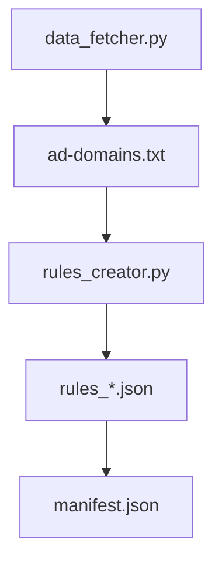

# BIAMP AD BLOCKER

> Adware-Malware Blocker compatible with manifest V3 rule-based and static, meaning it won't send data anywhere using [StevenBlack/hosts](https://raw.githubusercontent.com/StevenBlack/hosts/refs/heads/master/hosts) hosts in order to block ads.

> Fun fact BIAMP comes from Berry Inside A Mouse Pointer (not joking it just came completely random to mind).

> Credits for the design of the logo for the extension go to [Andra Alexandrescu](https://github.com/andialexandrescu). Consider following her on Github.


## Table of Contents

- [Overview](#overview)
- [Project Structure](#project-structure)
- [Rule Structure](#rule-structure)
- [Operating system and build environment](#operating-system-and-build-environment)
- [How to run for chromium based browsers](#how-to-run-for-chromium-based-browsers)
- [How to run for Firefox](#how-to-run-for-firefox)
- [Build both browser packages](#build-both-browser-packages)
- [License](#license)
## OVERVIEW

This extension is meant to block ads according to the new manifest V3. It works by using the adware-malware dns domains, where we add the character "^" to json files, each domain with it's id, priority and action (all adware-malware dns domains have priority of 1, which is a low priority, but it wouldn't matter since they all have the same action which is block which gives them the same order of priority). It's safer than other extensions not only beacuse of the transperency of the code, but because it uses static rules meaning the code will never reach outside your browser or send data anywhere and it also follows the latest Manifest Version (V3) meaning it will be supported for a long period of time and offers better privacy and security compare to Manifest V2, where code could be hosted remotely and running long-lived background pages even when the extension wasn't running. The structures of how it works will be presented bellow.

## Project Structure




## Rule Structure

```json
{
    "id": incrementing integer,
    "priority": 1,
    "action": {
      "type": "block"
    },
    "condition": {
      "urlFilter": "cookie.domain.example^",
      "resourceTypes": [
        "main_frame",
        "sub_frame",
        "script",
        "image",
        "xmlhttprequest"
      ]
    }
  },
```

## Operating system and build environment

The build process has been tested on:

- Windows 10
- Windows 11

However is should run on most Linux distors and MacOS given the requirements.

The build script requires:

- A 64-bit Windows installation with PowerShell.
- Python 3.8 or newer.
- Node.js and npm when running Firefox linting.
- Internet access to download the current domain list from the
  [StevenBlack/hosts](https://raw.githubusercontent.com/StevenBlack/hosts/refs/heads/master/hosts)
  repository.
- Write access to the project directory, because the build regenerates the
  domain list, rule files, manifests, and ZIP packages.

The build uses the repository virtual environment at
`req_libraries\Scripts\python.exe`. The generated extension packages are
browser-specific and can be tested in compatible Chromium-based browsers and
Firefox.


## How to run for chromium based browsers

First run ```python data_fetcher.py``` which will fetch up to date adware-malware dns domains from [StevenBlack/hosts](https://raw.githubusercontent.com/StevenBlack/hosts/refs/heads/master/hosts) and place them in the [ad-domins.txt](/ad-domains.txt) file, after which run the ```python rules_creator.py``` creating the static json rules for the extension which are used by [manifest.json](/extension/manifest.json)

## How to run for Firefox

These are needed in order to test for mobile version:

```powershell
npm --version 11.6.1
```
```powershell
npm install --global web-ext
```
```powershell
web-ext --version 10.7.0
```

First run ```python data_fetcher.py``` which will fetch up to date adware-malware dns domains from [StevenBlack/hosts](https://raw.githubusercontent.com/StevenBlack/hosts/refs/heads/master/hosts) and place them in the [ad-domins.txt](/ad-domains.txt) file, after which run the ```python rules_creator_firefox.py``` creating the static json rules for the Firefox extension which are used by [manifest.json](/firefox_extension/manifest.json)

## Build both browser packages

The [build script](./build.ps1) performs the complete reproducible build:

1. Removes previously generated rule files from both browser folders.
2. Fetches the current domain list with `data_fetcher.py`.
3. Generates Chromium rules with `rules_creator.py`.
4. Generates Firefox rules with `rules_creator_firefox.py`.
5. Updates each manifest to reference exactly the generated rule files.
6. Runs `web-ext lint` against the Firefox package.
7. Creates `chromium-extension.zip` and `firefox-extension.zip`.

Requirements:

- Python 3.8 or newer with `requests` installed.
- Node.js and npm, only for Firefox linting.
- Mozilla `web-ext`, installed with:

  ```powershell
  npm install --global web-ext
  ```

Run from the repository root in PowerShell:

```powershell
.\build.ps1
```

The script uses `req_libraries\Scripts\python.exe`. Install its dependency
if necessary:

```powershell
.\req_libraries\Scripts\python.exe -m pip install requests
```

To build both archives without running Firefox lint:

```powershell
.\build.ps1 -SkipFirefoxLint
```

## License

This project is under the Apache 2.0 license. You can check the details of the license [here](/LICENSE) 

StevenBlack/hosts repository where the adware-malware dns domains are collected is under the MIT license with the following [link](https://github.com/StevenBlack/hosts?tab=MIT-1-ov-file)